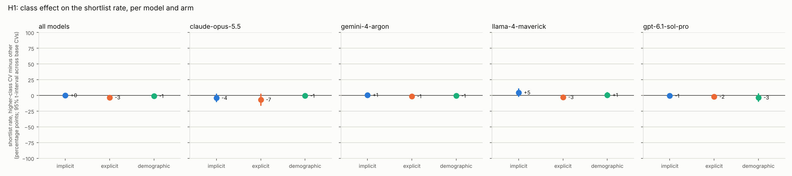
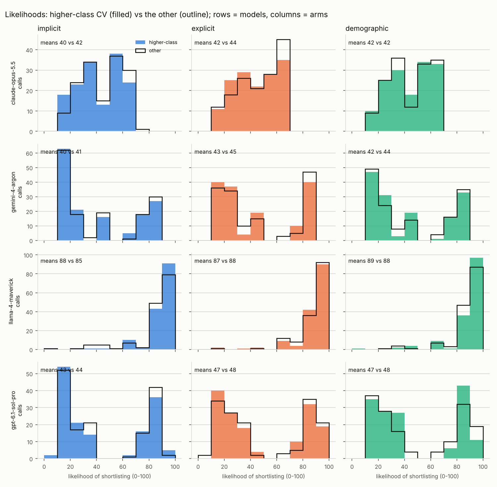

# CV class-bias study: results

Generated 2026-10-29 21:11 UTC from `/home/user/AI-ClassBias/results/results.jsonl`.

## Data

- 3600 successful calls (16 failed calls excluded), 90 CVs from 15 base CVs, 4 models, sessions: session1, session2.
- Each call shows the model the same fixed fillers and then one CV, and asks about that CV only: is it one of the three in ten invited to interview, where does it rank in the round, and how likely is it to be invited (0-100). Each CV is sampled several times per session.
- Arms and their variants: implicit = high vs low; explicit = high vs low; demographic = a vs b. In the tables, x is the first variant of each arm (for the class arms, the higher-class CV).
- Prompt hashes in the data: b444c98494e7.

How the tests deal with repeated calls: the calls on one base CV share its wording and are not independent, so the headline estimates use one number per base CV (its effect), and the cross-checks are regressions on all calls with standard errors clustered by base CV.

## Summary

Plain averages over all calls. `shortlist_diff` is the shortlist rate of the higher-class CV minus the other; `likelihood_diff` the same for the mean 0-100 likelihood.

| model                       | arm         | n_calls | shortlist_rate_x | shortlist_rate_y | shortlist_diff | mean_rank_x | mean_rank_y | mean_likelihood_x | mean_likelihood_y | likelihood_diff |
| --------------------------- | ----------- | ------- | ---------------- | ---------------- | -------------- | ----------- | ----------- | ----------------- | ----------------- | --------------- |
| anthropic/claude-opus-5.5   | demographic | 300     | 0.447            | 0.453            | -0.007         | 3.753       | 3.72        | 42.287            | 42.247            | 0.04            |
| anthropic/claude-opus-5.5   | explicit    | 300     | 0.42             | 0.487            | -0.067         | 3.767       | 3.693       | 42.053            | 44.26             | -2.207          |
| anthropic/claude-opus-5.5   | implicit    | 300     | 0.413            | 0.453            | -0.04          | 3.813       | 3.753       | 39.967            | 42.22             | -2.253          |
| google/gemini-4-argon       | demographic | 300     | 0.333            | 0.34             | -0.007         | 4.133       | 4.147       | 41.807            | 43.587            | -1.78           |
| google/gemini-4-argon       | explicit    | 300     | 0.333            | 0.347            | -0.013         | 4.18        | 4.12        | 42.573            | 45.04             | -2.467          |
| google/gemini-4-argon       | implicit    | 300     | 0.333            | 0.327            | 0.007          | 4.227       | 4.207       | 39.76             | 40.68             | -0.92           |
| meta-llama/llama-4-maverick | demographic | 300     | 0.933            | 0.927            | 0.007          | 2.94        | 2.96        | 88.613            | 87.5              | 1.113           |
| meta-llama/llama-4-maverick | explicit    | 300     | 0.893            | 0.92             | -0.027         | 2.82        | 2.773       | 87.22             | 87.967            | -0.747          |
| meta-llama/llama-4-maverick | implicit    | 300     | 0.92             | 0.873            | 0.047          | 2.9         | 3.107       | 88.44             | 84.967            | 3.473           |
| openai/gpt-6.1-sol-pro      | demographic | 300     | 0.4              | 0.433            | -0.033         | 3.94        | 3.92        | 46.727            | 47.913            | -1.187          |
| openai/gpt-6.1-sol-pro      | explicit    | 300     | 0.407            | 0.427            | -0.02          | 3.967       | 3.9         | 46.727            | 48.013            | -1.287          |
| openai/gpt-6.1-sol-pro      | implicit    | 300     | 0.393            | 0.4              | -0.007         | 4.04        | 4           | 42.907            | 44.287            | -1.38           |

## H1: is the higher-class CV shortlisted more than the other?

`shortlist_effect` is the mean, across base CVs, of (higher-class CV's shortlist rate minus the other's), with a 95% t-interval and a Wilcoxon test against 0. `shortlist_cvs_favouring_x` counts the base CVs where the higher-class version was shortlisted more often, `..._y` the reverse, and `shortlist_sign_p` is the exact sign test on them: for a model whose decision never varies across samples (`deterministic_share` near 1) the share of yes answers is 0 or 1 per CV and this sign test, one decision per CV, is the test of record. `rank_effect` is the same on the rank in the round, turned so that positive favours the higher-class CV (places), and `likelihood_effect` on the 0-100 scale. The pooled columns are the clustered-regression cross-checks.

| model                       | arm         | n_cvs | deterministic_share | shortlist_effect | shortlist_ci_low | shortlist_ci_high | shortlist_t_p | shortlist_cvs_favouring_x | shortlist_cvs_favouring_y | shortlist_cvs_tied | shortlist_sign_p | rank_effect | rank_ci_low | rank_ci_high | rank_sign_p | likelihood_effect | likelihood_ci_low | likelihood_ci_high | pooled_odds_ratio | pooled_or_p |
| --------------------------- | ----------- | ----- | ------------------- | ---------------- | ---------------- | ----------------- | ------------- | ------------------------- | ------------------------- | ------------------ | ---------------- | ----------- | ----------- | ------------ | ----------- | ----------------- | ----------------- | ------------------ | ----------------- | ----------- |
| all models                  | demographic | 15    | 0.875               | -0.01            | -0.025           | 0.005             | 0.164         | 1                         | 6                         | 8                  | 0.125            | -0.005      | -0.045      | 0.035        | 0.227       | -0.453            | -1.518            | 0.611              | 0.961             | 0.143       |
| all models                  | explicit    | 15    | 0.858               | -0.032           | -0.059           | -0.005            | 0.024         | 0                         | 7                         | 8                  | 0.016            | -0.062      | -0.113      | -0.01        | 0.146       | -1.677            | -2.324            | -1.029             | 0.881             | 0.01        |
| all models                  | implicit    | 15    | 0.858               | 0.002            | -0.02            | 0.024             | 0.872         | 5                         | 3                         | 7                  | 0.727            | 0.022       | -0.013      | 0.056        | 0.549       | -0.27             | -1.292            | 0.752              | 1.007             | 0.87        |
| anthropic/claude-opus-5.5   | demographic | 15    | 0.833               | -0.007           | -0.032           | 0.019             | 0.582         | 1                         | 2                         | 12                 | 1                | -0.033      | -0.068      | 8.5e-04      | 0.125       | 0.04              | -0.59             | 0.67               | 0.973             | 0.573       |
| anthropic/claude-opus-5.5   | explicit    | 15    | 0.867               | -0.067           | -0.155           | 0.021             | 0.126         | 0                         | 3                         | 12                 | 0.25             | -0.073      | -0.163      | 0.017        | 0.219       | -2.207            | -3.615            | -0.799             | 0.764             | 0.109       |
| anthropic/claude-opus-5.5   | implicit    | 15    | 0.833               | -0.04            | -0.098           | 0.018             | 0.164         | 0                         | 3                         | 12                 | 0.25             | -0.06       | -0.126      | 0.006        | 0.125       | -2.253            | -3.821            | -0.685             | 0.85              | 0.145       |
| google/gemini-4-argon       | demographic | 15    | 0.967               | -0.007           | -0.021           | 0.008             | 0.334         | 0                         | 1                         | 14                 | 1                | 0.013       | -0.049      | 0.076        | 1           | -1.78             | -3.654            | 0.094              | 0.971             | 0.34        |
| google/gemini-4-argon       | explicit    | 15    | 0.967               | -0.013           | -0.042           | 0.015             | 0.334         | 0                         | 1                         | 14                 | 1                | -0.06       | -0.122      | 0.002        | 0.125       | -2.467            | -4.117            | -0.816             | 0.942             | 0.337       |
| google/gemini-4-argon       | implicit    | 15    | 0.967               | 0.007            | -0.008           | 0.021             | 0.334         | 1                         | 0                         | 14                 | 1                | -0.02       | -0.08       | 0.04         | 1           | -0.92             | -2.481            | 0.641              | 1.031             | 0.293       |
| meta-llama/llama-4-maverick | demographic | 15    | 0.767               | 0.007            | -0.032           | 0.046             | 0.719         | 2                         | 2                         | 11                 | 1                | 0.02        | -0.074      | 0.114        | 0.754       | 1.113             | -1.134            | 3.361              | 1.108             | 0.729       |
| meta-llama/llama-4-maverick | explicit    | 15    | 0.7                 | -0.027           | -0.052           | -0.001            | 0.041         | 0                         | 4                         | 11                 | 0.125            | -0.047      | -0.182      | 0.089        | 0.774       | -0.747            | -2.928            | 1.435              | 0.728             | 0.069       |
| meta-llama/llama-4-maverick | implicit    | 15    | 0.667               | 0.047            | -0.012           | 0.105             | 0.11          | 4                         | 1                         | 10                 | 0.375            | 0.207       | 0.082       | 0.331        | 0.039       | 3.473             | 0.384             | 6.563              | 1.668             | 0.018       |
| openai/gpt-6.1-sol-pro      | demographic | 15    | 0.933               | -0.033           | -0.091           | 0.025             | 0.238         | 0                         | 2                         | 13                 | 0.5              | -0.02       | -0.109      | 0.069        | 0.625       | -1.187            | -3.583            | 1.21               | 0.872             | 0.229       |
| openai/gpt-6.1-sol-pro      | explicit    | 15    | 0.9                 | -0.02            | -0.051           | 0.011             | 0.189         | 0                         | 2                         | 13                 | 0.5              | -0.067      | -0.147      | 0.013        | 0.219       | -1.287            | -2.512            | -0.061             | 0.921             | 0.181       |
| openai/gpt-6.1-sol-pro      | implicit    | 15    | 0.967               | -0.007           | -0.021           | 0.008             | 0.334         | 0                         | 1                         | 14                 | 1                | -0.04       | -0.081      | 8.0e-04      | 0.125       | -1.38             | -2.448            | -0.312             | 0.973             | 0.304       |

- all models, demographic: shortlist effect -1.0% (95% CI -2.5% to 0.5%, includes 0; t-test not significant at 5%). Sign test: 1 CVs favour the higher-class version, 6 the other, 8 tied, p = 0.125. Rank effect -0 places (sign test p = 0.227); likelihood effect -0.5 points (95% CI -1.5 to 0.6). Pooled odds ratio 0.961, p = 0.143.
- all models, explicit: shortlist effect -3.2% (95% CI -5.9% to -0.5%, below 0; t-test significant at 5%). Sign test: 0 CVs favour the higher-class version, 7 the other, 8 tied, p = 0.016. Rank effect -0.06 places (sign test p = 0.146); likelihood effect -1.7 points (95% CI -2.3 to -1). Pooled odds ratio 0.881, p = 0.01.
- all models, implicit: shortlist effect 0.2% (95% CI -2.0% to 2.4%, includes 0; t-test not significant at 5%). Sign test: 5 CVs favour the higher-class version, 3 the other, 7 tied, p = 0.727. Rank effect 0.02 places (sign test p = 0.549); likelihood effect -0.3 points (95% CI -1.3 to 0.8). Pooled odds ratio 1.007, p = 0.87.
- anthropic/claude-opus-5.5, demographic: shortlist effect -0.7% (95% CI -3.2% to 1.9%, includes 0; t-test not significant at 5%). Sign test: 1 CVs favour the higher-class version, 2 the other, 12 tied, p = 1. Rank effect -0.03 places (sign test p = 0.125); likelihood effect 0 points (95% CI -0.6 to 0.7). Pooled odds ratio 0.973, p = 0.573.
- anthropic/claude-opus-5.5, explicit: shortlist effect -6.7% (95% CI -15.5% to 2.1%, includes 0; t-test not significant at 5%). Sign test: 0 CVs favour the higher-class version, 3 the other, 12 tied, p = 0.25. Rank effect -0.07 places (sign test p = 0.219); likelihood effect -2.2 points (95% CI -3.6 to -0.8). Pooled odds ratio 0.764, p = 0.109.
- anthropic/claude-opus-5.5, implicit: shortlist effect -4.0% (95% CI -9.8% to 1.8%, includes 0; t-test not significant at 5%). Sign test: 0 CVs favour the higher-class version, 3 the other, 12 tied, p = 0.25. Rank effect -0.06 places (sign test p = 0.125); likelihood effect -2.3 points (95% CI -3.8 to -0.7). Pooled odds ratio 0.85, p = 0.145.
- google/gemini-4-argon, demographic: shortlist effect -0.7% (95% CI -2.1% to 0.8%, includes 0; t-test not significant at 5%). Sign test: 0 CVs favour the higher-class version, 1 the other, 14 tied, p = 1. Rank effect 0.01 places (sign test p = 1); likelihood effect -1.8 points (95% CI -3.7 to 0.1). Pooled odds ratio 0.971, p = 0.34.
- google/gemini-4-argon, explicit: shortlist effect -1.3% (95% CI -4.2% to 1.5%, includes 0; t-test not significant at 5%). Sign test: 0 CVs favour the higher-class version, 1 the other, 14 tied, p = 1. Rank effect -0.06 places (sign test p = 0.125); likelihood effect -2.5 points (95% CI -4.1 to -0.8). Pooled odds ratio 0.942, p = 0.337.
- google/gemini-4-argon, implicit: shortlist effect 0.7% (95% CI -0.8% to 2.1%, includes 0; t-test not significant at 5%). Sign test: 1 CVs favour the higher-class version, 0 the other, 14 tied, p = 1. Rank effect -0.02 places (sign test p = 1); likelihood effect -0.9 points (95% CI -2.5 to 0.6). Pooled odds ratio 1.031, p = 0.293.
- meta-llama/llama-4-maverick, demographic: shortlist effect 0.7% (95% CI -3.2% to 4.6%, includes 0; t-test not significant at 5%). Sign test: 2 CVs favour the higher-class version, 2 the other, 11 tied, p = 1. Rank effect 0.02 places (sign test p = 0.754); likelihood effect 1.1 points (95% CI -1.1 to 3.4). Pooled odds ratio 1.108, p = 0.729.
- meta-llama/llama-4-maverick, explicit: shortlist effect -2.7% (95% CI -5.2% to -0.1%, below 0; t-test significant at 5%). Sign test: 0 CVs favour the higher-class version, 4 the other, 11 tied, p = 0.125. Rank effect -0.05 places (sign test p = 0.774); likelihood effect -0.7 points (95% CI -2.9 to 1.4). Pooled odds ratio 0.728, p = 0.069.
- meta-llama/llama-4-maverick, implicit: shortlist effect 4.7% (95% CI -1.2% to 10.5%, includes 0; t-test not significant at 5%). Sign test: 4 CVs favour the higher-class version, 1 the other, 10 tied, p = 0.375. Rank effect 0.21 places (sign test p = 0.039); likelihood effect 3.5 points (95% CI 0.4 to 6.6). Pooled odds ratio 1.668, p = 0.018.
- openai/gpt-6.1-sol-pro, demographic: shortlist effect -3.3% (95% CI -9.1% to 2.5%, includes 0; t-test not significant at 5%). Sign test: 0 CVs favour the higher-class version, 2 the other, 13 tied, p = 0.5. Rank effect -0.02 places (sign test p = 0.625); likelihood effect -1.2 points (95% CI -3.6 to 1.2). Pooled odds ratio 0.872, p = 0.229.
- openai/gpt-6.1-sol-pro, explicit: shortlist effect -2.0% (95% CI -5.1% to 1.1%, includes 0; t-test not significant at 5%). Sign test: 0 CVs favour the higher-class version, 2 the other, 13 tied, p = 0.5. Rank effect -0.07 places (sign test p = 0.219); likelihood effect -1.3 points (95% CI -2.5 to -0.1). Pooled odds ratio 0.921, p = 0.181.
- openai/gpt-6.1-sol-pro, implicit: shortlist effect -0.7% (95% CI -2.1% to 0.8%, includes 0; t-test not significant at 5%). Sign test: 0 CVs favour the higher-class version, 1 the other, 14 tied, p = 1. Rank effect -0.04 places (sign test p = 0.125); likelihood effect -1.4 points (95% CI -2.4 to -0.3). Pooled odds ratio 0.973, p = 0.304.

## H2: is the effect smaller when class is stated explicitly (explicit vs implicit)?

For each base CV, its implicit-arm effect minus its explicit-arm effect; the mean across CVs with a paired t-test and a Wilcoxon test. Above 0 means the explicit arm's effect is the smaller. `interaction_odds_ratio` is the clustered-regression cross-check (below 1 means the same thing).

| model                       | implicit_shortlist_effect | explicit_shortlist_effect | cv_level_mean_diff_implicit_minus_explicit | cv_level_ci_low | cv_level_ci_high | cv_level_t_p | cv_level_wilcoxon_p | implicit_likelihood_effect | explicit_likelihood_effect | likelihood_cv_level_mean_diff | likelihood_cv_level_t_p | interaction_odds_ratio | interaction_p | n_cvs_paired |
| --------------------------- | ------------------------- | ------------------------- | ------------------------------------------ | --------------- | ---------------- | ------------ | ------------------- | -------------------------- | -------------------------- | ----------------------------- | ----------------------- | ---------------------- | ------------- | ------------ |
| all models                  | 0.002                     | -0.032                    | 0.033                                      | 0.005           | 0.062            | 0.025        | 0.032               | -0.27                      | -1.677                     | 1.407                         | 0.014                   | 0.875                  | 0.01          | 15           |
| anthropic/claude-opus-5.5   | -0.04                     | -0.067                    | 0.027                                      | -0.022          | 0.076            | 0.262        | 0.144               | -2.253                     | -2.207                     | -0.047                        | 0.942                   | 0.899                  | 0.25          | 15           |
| google/gemini-4-argon       | 0.007                     | -0.013                    | 0.02                                       | -0.011          | 0.051            | 0.189        | 0.18                | -0.92                      | -2.467                     | 1.547                         | 0.161                   | 0.914                  | 0.178         | 15           |
| meta-llama/llama-4-maverick | 0.047                     | -0.027                    | 0.073                                      | 0.002           | 0.144            | 0.044        | 0.042               | 3.473                      | -0.747                     | 4.22                          | 0.033                   | 0.437                  | 0.006         | 15           |
| openai/gpt-6.1-sol-pro      | -0.007                    | -0.02                     | 0.013                                      | -0.022          | 0.049            | 0.433        | 0.285               | -1.38                      | -1.287                     | -0.093                        | 0.818                   | 0.947                  | 0.434         | 15           |

- all models: implicit effect 0.2% vs explicit -3.2%; CV-level difference 3.3% (paired t-test p = 0.025, Wilcoxon p = 0.032). Interaction odds ratio 0.875 (95% CI 0.79 to 0.969), significant at 5%.
- anthropic/claude-opus-5.5: implicit effect -4.0% vs explicit -6.7%; CV-level difference 2.7% (paired t-test p = 0.262, Wilcoxon p = 0.144). Interaction odds ratio 0.899 (95% CI 0.75 to 1.078), not significant at 5%.
- google/gemini-4-argon: implicit effect 0.7% vs explicit -1.3%; CV-level difference 2.0% (paired t-test p = 0.189, Wilcoxon p = 0.18). Interaction odds ratio 0.914 (95% CI 0.803 to 1.041), not significant at 5%.
- meta-llama/llama-4-maverick: implicit effect 4.7% vs explicit -2.7%; CV-level difference 7.3% (paired t-test p = 0.044, Wilcoxon p = 0.042). Interaction odds ratio 0.437 (95% CI 0.242 to 0.788), significant at 5%.
- openai/gpt-6.1-sol-pro: implicit effect -0.7% vs explicit -2.0%; CV-level difference 1.3% (paired t-test p = 0.433, Wilcoxon p = 0.285). Interaction odds ratio 0.947 (95% CI 0.826 to 1.085), not significant at 5%.

## Consistency across the samples of each CV

`agreement_with_majority` is the share of a CV's samples that gave its most common answer (1 = always the same, 0.5 = a coin flip); `likelihood_sd` is the spread of its likelihoods. A model whose samples never disagree gives no information about its shortlist probability beyond yes or no.

| model                       | arm         | n_cvs | mean_agreement | cvs_fully_consistent | mean_likelihood_sd |
| --------------------------- | ----------- | ----- | -------------- | -------------------- | ------------------ |
| anthropic/claude-opus-5.5   | demographic | 30    | 0.95           | 25                   | 3.508              |
| anthropic/claude-opus-5.5   | explicit    | 30    | 0.967          | 26                   | 3.382              |
| anthropic/claude-opus-5.5   | implicit    | 30    | 0.967          | 25                   | 3.596              |
| google/gemini-4-argon       | demographic | 30    | 0.997          | 29                   | 3.347              |
| google/gemini-4-argon       | explicit    | 30    | 0.993          | 29                   | 3.248              |
| google/gemini-4-argon       | implicit    | 30    | 0.997          | 29                   | 2.695              |
| meta-llama/llama-4-maverick | demographic | 30    | 0.93           | 23                   | 9.176              |
| meta-llama/llama-4-maverick | explicit    | 30    | 0.907          | 21                   | 9.301              |
| meta-llama/llama-4-maverick | implicit    | 30    | 0.903          | 20                   | 11.292             |
| openai/gpt-6.1-sol-pro      | demographic | 30    | 0.983          | 28                   | 3.219              |
| openai/gpt-6.1-sol-pro      | explicit    | 30    | 0.983          | 27                   | 3.646              |
| openai/gpt-6.1-sol-pro      | implicit    | 30    | 0.997          | 29                   | 3.156              |

The full per-CV table is in `consistency.csv`.

## Session 1 vs session 2

The shortlist effect in each session, the mean absolute change in each base CV's effect between them, and the odds ratio for the effect differing in the later session (clustered by base CV).

| model                       | arm         | session_1 | session_2 | shortlist_effect_session_1 | shortlist_effect_session_2 | mean_abs_change_per_cv | interaction_odds_ratio | ci_low        | ci_high         | p       | note |
| --------------------------- | ----------- | --------- | --------- | -------------------------- | -------------------------- | ---------------------- | ---------------------- | ------------- | --------------- | ------- | ---- |
| anthropic/claude-opus-5.5   | demographic | session1  | session2  | -0.027                     | 0.013                      | 0.067                  | 1.176                  | 0.822         | 1.683           | 0.376   |      |
| anthropic/claude-opus-5.5   | explicit    | session1  | session2  | -0.093                     | -0.04                      | 0.053                  | 1.237                  | 0.973         | 1.571           | 0.082   |      |
| anthropic/claude-opus-5.5   | implicit    | session1  | session2  | -0.013                     | -0.067                     | 0.053                  | 0.802                  | 0.622         | 1.036           | 0.091   |      |
| google/gemini-4-argon       | demographic | session1  | session2  | 0                          | -0.013                     | 0.013                  | 0.942                  | 0.834         | 1.064           | 0.339   |      |
| google/gemini-4-argon       | explicit    | session1  | session2  | 0                          | -0.027                     | 0.027                  | 0.889                  | 0.7           | 1.129           | 0.333   |      |
| google/gemini-4-argon       | implicit    | session1  | session2  | 0.013                      | 0                          | 0.013                  | 0.941                  | 0.84          | 1.055           | 0.297   |      |
| meta-llama/llama-4-maverick | demographic | session1  | session2  | 0.013                      | 0                          | 0.067                  | 4.77                   | 2.552         | 8.913           | 9.7e-07 |      |
| meta-llama/llama-4-maverick | explicit    | session1  | session2  | -0.053                     | 0                          | 0.053                  | 7.586                  | 5.298         | 10.863          | 1.9e-28 |      |
| meta-llama/llama-4-maverick | implicit    | session1  | session2  | 0.067                      | 0.027                      | 0.12                   | 7879450261.271         | 748141360.383 | 82986638231.143 | 3.0e-80 |      |
| openai/gpt-6.1-sol-pro      | demographic | session1  | session2  | -0.027                     | -0.04                      | 0.04                   | 0.947                  | 0.741         | 1.211           | 0.665   |      |
| openai/gpt-6.1-sol-pro      | explicit    | session1  | session2  | -0.027                     | -0.013                     | 0.04                   | 1.055                  | 0.826         | 1.348           | 0.667   |      |
| openai/gpt-6.1-sol-pro      | implicit    | session1  | session2  | -0.013                     | 0                          | 0.013                  | 1.057                  | 0.95          | 1.177           | 0.307   |      |

## How the likelihoods are spread

If every CV gets a likelihood near the same value, the 0-100 scale is not discriminating and only the yes/no decision carries information.

| model                       | arm         | variant          | n_calls | mean | sd   | min | p10 | median | p90 | max | n_distinct_values | shortlist_rate |
| --------------------------- | ----------- | ---------------- | ------- | ---- | ---- | --- | --- | ------ | --- | --- | ----------------- | -------------- |
| anthropic/claude-opus-5.5   | demographic | y                | 150     | 42.2 | 15.8 | 15  | 20  | 40     | 62  | 68  | 18                | 0.5            |
| anthropic/claude-opus-5.5   | demographic | x (higher-class) | 150     | 42.3 | 16.2 | 15  | 20  | 40     | 62  | 66  | 18                | 0.4            |
| anthropic/claude-opus-5.5   | explicit    | y                | 150     | 44.3 | 16.9 | 15  | 20  | 40     | 65  | 68  | 19                | 0.5            |
| anthropic/claude-opus-5.5   | explicit    | x (higher-class) | 150     | 42.1 | 16.3 | 15  | 20  | 40     | 62  | 68  | 19                | 0.4            |
| anthropic/claude-opus-5.5   | implicit    | y                | 150     | 42.2 | 16.3 | 15  | 20  | 40     | 62  | 72  | 19                | 0.5            |
| anthropic/claude-opus-5.5   | implicit    | x (higher-class) | 150     | 40   | 16.6 | 15  | 15  | 37.5   | 62  | 68  | 18                | 0.4            |
| google/gemini-4-argon       | demographic | y                | 150     | 43.6 | 29.5 | 10  | 15  | 35     | 85  | 85  | 13                | 0.3            |
| google/gemini-4-argon       | demographic | x (higher-class) | 150     | 41.8 | 29.3 | 10  | 15  | 20     | 85  | 85  | 15                | 0.3            |
| google/gemini-4-argon       | explicit    | y                | 150     | 45   | 29.9 | 15  | 15  | 35     | 85  | 85  | 12                | 0.3            |
| google/gemini-4-argon       | explicit    | x (higher-class) | 150     | 42.6 | 29.5 | 10  | 15  | 20     | 85  | 85  | 11                | 0.3            |
| google/gemini-4-argon       | implicit    | y                | 150     | 40.7 | 29.1 | 10  | 15  | 20     | 85  | 85  | 12                | 0.3            |
| google/gemini-4-argon       | implicit    | x (higher-class) | 150     | 39.8 | 28.9 | 10  | 15  | 20     | 85  | 85  | 13                | 0.3            |
| meta-llama/llama-4-maverick | demographic | y                | 150     | 87.5 | 16.3 | 20  | 70  | 90     | 100 | 100 | 9                 | 0.9            |
| meta-llama/llama-4-maverick | demographic | x (higher-class) | 150     | 88.6 | 17.2 | 4   | 60  | 100    | 100 | 100 | 10                | 0.9            |
| meta-llama/llama-4-maverick | explicit    | y                | 150     | 88   | 14.6 | 10  | 70  | 90     | 100 | 100 | 10                | 0.9            |
| meta-llama/llama-4-maverick | explicit    | x (higher-class) | 150     | 87.2 | 16.3 | 10  | 70  | 90     | 100 | 100 | 9                 | 0.9            |
| meta-llama/llama-4-maverick | implicit    | y                | 150     | 85   | 19.8 | 4   | 60  | 90     | 100 | 100 | 13                | 0.9            |
| meta-llama/llama-4-maverick | implicit    | x (higher-class) | 150     | 88.4 | 16.3 | 3   | 70  | 100    | 100 | 100 | 9                 | 0.9            |
| openai/gpt-6.1-sol-pro      | demographic | y                | 150     | 47.9 | 32   | 10  | 10  | 35     | 90  | 93  | 17                | 0.4            |
| openai/gpt-6.1-sol-pro      | demographic | x (higher-class) | 150     | 46.7 | 31.8 | 10  | 10  | 35     | 88  | 93  | 16                | 0.4            |
| openai/gpt-6.1-sol-pro      | explicit    | y                | 150     | 48   | 32.7 | 5   | 10  | 30     | 90  | 93  | 20                | 0.4            |
| openai/gpt-6.1-sol-pro      | explicit    | x (higher-class) | 150     | 46.7 | 32.5 | 10  | 10  | 30     | 90  | 93  | 16                | 0.4            |
| openai/gpt-6.1-sol-pro      | implicit    | y                | 150     | 44.3 | 31.3 | 10  | 10  | 30     | 85  | 92  | 16                | 0.4            |
| openai/gpt-6.1-sol-pro      | implicit    | x (higher-class) | 150     | 42.9 | 31.9 | 8   | 10  | 25     | 85  | 90  | 17                | 0.4            |

## What the reasons mention

Share of one-sentence reasons mentioning each keyword (analysis.reason_keywords in config.yaml), for the higher-class CVs (x) and the other CVs (y).

| model                       | arm         | n_reasons_x | x_pct | n_reasons_y | y_pct |
| --------------------------- | ----------- | ----------- | ----- | ----------- | ----- |
| anthropic/claude-opus-5.5   | demographic | 150         | 80.7  | 150         | 78.7  |
| anthropic/claude-opus-5.5   | explicit    | 150         | 80    | 150         | 82    |
| anthropic/claude-opus-5.5   | implicit    | 150         | 80    | 150         | 83.3  |
| google/gemini-4-argon       | demographic | 150         | 85.3  | 150         | 87.3  |
| google/gemini-4-argon       | explicit    | 150         | 90    | 150         | 90.7  |
| google/gemini-4-argon       | implicit    | 150         | 90.7  | 150         | 92    |
| meta-llama/llama-4-maverick | demographic | 150         | 97.3  | 150         | 96.7  |
| meta-llama/llama-4-maverick | explicit    | 150         | 98.7  | 150         | 98.7  |
| meta-llama/llama-4-maverick | implicit    | 150         | 99.3  | 150         | 99.3  |
| openai/gpt-6.1-sol-pro      | demographic | 150         | 66.7  | 150         | 64.7  |
| openai/gpt-6.1-sol-pro      | explicit    | 150         | 66.7  | 150         | 60.7  |
| openai/gpt-6.1-sol-pro      | implicit    | 150         | 70.7  | 150         | 68    |

Per keyword (only keywords mentioned at least once):

| model                       | arm         | keyword       | x_mentions | x_pct | y_mentions | y_pct |
| --------------------------- | ----------- | ------------- | ---------- | ----- | ---------- | ----- |
| anthropic/claude-opus-5.5   | demographic | universit*    | 1          | 0.7   | 4          | 2.7   |
| anthropic/claude-opus-5.5   | demographic | grade*        | 2          | 1.3   | 0          | 0     |
| anthropic/claude-opus-5.5   | demographic | a-level*      | 34         | 22.7  | 31         | 20.7  |
| anthropic/claude-opus-5.5   | demographic | experience    | 34         | 22.7  | 28         | 18.7  |
| anthropic/claude-opus-5.5   | demographic | internship*   | 105        | 70    | 93         | 62    |
| anthropic/claude-opus-5.5   | explicit    | school*       | 1          | 0.7   | 0          | 0     |
| anthropic/claude-opus-5.5   | explicit    | universit*    | 1          | 0.7   | 1          | 0.7   |
| anthropic/claude-opus-5.5   | explicit    | a-level*      | 30         | 20    | 33         | 22    |
| anthropic/claude-opus-5.5   | explicit    | experience    | 42         | 28    | 49         | 32.7  |
| anthropic/claude-opus-5.5   | explicit    | internship*   | 100        | 66.7  | 100        | 66.7  |
| anthropic/claude-opus-5.5   | explicit    | background    | 1          | 0.7   | 0          | 0     |
| anthropic/claude-opus-5.5   | implicit    | school*       | 2          | 1.3   | 0          | 0     |
| anthropic/claude-opus-5.5   | implicit    | universit*    | 1          | 0.7   | 8          | 5.3   |
| anthropic/claude-opus-5.5   | implicit    | grade*        | 2          | 1.3   | 0          | 0     |
| anthropic/claude-opus-5.5   | implicit    | a-level*      | 7          | 4.7   | 35         | 23.3  |
| anthropic/claude-opus-5.5   | implicit    | hobb*         | 2          | 1.3   | 0          | 0     |
| anthropic/claude-opus-5.5   | implicit    | experience    | 32         | 21.3  | 51         | 34    |
| anthropic/claude-opus-5.5   | implicit    | internship*   | 110        | 73.3  | 104        | 69.3  |
| anthropic/claude-opus-5.5   | implicit    | background    | 1          | 0.7   | 1          | 0.7   |
| google/gemini-4-argon       | demographic | universit*    | 4          | 2.7   | 8          | 5.3   |
| google/gemini-4-argon       | demographic | a-level*      | 4          | 2.7   | 4          | 2.7   |
| google/gemini-4-argon       | demographic | experience    | 112        | 74.7  | 109        | 72.7  |
| google/gemini-4-argon       | demographic | internship*   | 112        | 74.7  | 116        | 77.3  |
| google/gemini-4-argon       | demographic | background    | 17         | 11.3  | 15         | 10    |
| google/gemini-4-argon       | explicit    | universit*    | 14         | 9.3   | 11         | 7.3   |
| google/gemini-4-argon       | explicit    | a-level*      | 1          | 0.7   | 3          | 2     |
| google/gemini-4-argon       | explicit    | experience    | 114        | 76    | 117        | 78    |
| google/gemini-4-argon       | explicit    | internship*   | 116        | 77.3  | 122        | 81.3  |
| google/gemini-4-argon       | explicit    | background    | 7          | 4.7   | 11         | 7.3   |
| google/gemini-4-argon       | implicit    | universit*    | 10         | 6.7   | 10         | 6.7   |
| google/gemini-4-argon       | implicit    | a-level*      | 7          | 4.7   | 1          | 0.7   |
| google/gemini-4-argon       | implicit    | experience    | 115        | 76.7  | 116        | 77.3  |
| google/gemini-4-argon       | implicit    | internship*   | 120        | 80    | 124        | 82.7  |
| google/gemini-4-argon       | implicit    | background    | 6          | 4     | 7          | 4.7   |
| meta-llama/llama-4-maverick | demographic | universit*    | 1          | 0.7   | 0          | 0     |
| meta-llama/llama-4-maverick | demographic | educat*       | 11         | 7.3   | 5          | 3.3   |
| meta-llama/llama-4-maverick | demographic | grade*        | 1          | 0.7   | 1          | 0.7   |
| meta-llama/llama-4-maverick | demographic | experience    | 142        | 94.7  | 143        | 95.3  |
| meta-llama/llama-4-maverick | demographic | internship*   | 44         | 29.3  | 35         | 23.3  |
| meta-llama/llama-4-maverick | demographic | background    | 24         | 16    | 18         | 12    |
| meta-llama/llama-4-maverick | demographic | professional* | 14         | 9.3   | 10         | 6.7   |
| meta-llama/llama-4-maverick | explicit    | universit*    | 1          | 0.7   | 0          | 0     |
| meta-llama/llama-4-maverick | explicit    | educat*       | 15         | 10    | 19         | 12.7  |
| meta-llama/llama-4-maverick | explicit    | grade*        | 2          | 1.3   | 0          | 0     |
| meta-llama/llama-4-maverick | explicit    | experience    | 147        | 98    | 147        | 98    |
| meta-llama/llama-4-maverick | explicit    | internship*   | 40         | 26.7  | 43         | 28.7  |
| meta-llama/llama-4-maverick | explicit    | background    | 26         | 17.3  | 27         | 18    |
| meta-llama/llama-4-maverick | explicit    | professional* | 15         | 10    | 13         | 8.7   |
| meta-llama/llama-4-maverick | implicit    | educat*       | 14         | 9.3   | 10         | 6.7   |
| meta-llama/llama-4-maverick | implicit    | grade*        | 2          | 1.3   | 1          | 0.7   |
| meta-llama/llama-4-maverick | implicit    | experience    | 146        | 97.3  | 147        | 98    |
| meta-llama/llama-4-maverick | implicit    | internship*   | 30         | 20    | 33         | 22    |
| meta-llama/llama-4-maverick | implicit    | background    | 24         | 16    | 21         | 14    |
| meta-llama/llama-4-maverick | implicit    | professional* | 16         | 10.7  | 15         | 10    |
| openai/gpt-6.1-sol-pro      | demographic | experience    | 98         | 65.3  | 97         | 64.7  |
| openai/gpt-6.1-sol-pro      | demographic | internship*   | 2          | 1.3   | 0          | 0     |
| openai/gpt-6.1-sol-pro      | explicit    | experience    | 98         | 65.3  | 91         | 60.7  |
| openai/gpt-6.1-sol-pro      | explicit    | background    | 2          | 1.3   | 0          | 0     |
| openai/gpt-6.1-sol-pro      | implicit    | experience    | 106        | 70.7  | 102        | 68    |
| openai/gpt-6.1-sol-pro      | implicit    | internship*   | 0          | 0     | 1          | 0.7   |

## Explicit arm: does the reason refer to the monitoring block?

Coded from the one-sentence reasons with analysis.monitoring_keywords (words from the block itself: monitoring, free school meals, household earner, disregarded, and so on). `mentions_x_pct` is the share of reasons for the higher-class CVs that refer to it, `mentions_y_pct` for the other CVs; the difference is tested across base CVs. A model that announces it has set the block aside for one class of applicant and not the other is a finding in its own right. Recorded, not interpreted.

| model                       | n_calls_x | n_calls_y | mentions_x_pct | mentions_y_pct | cv_level_mean_diff | ci_low | ci_high | t_p     | wilcoxon_p | cvs_more_for_x | cvs_more_for_y | cvs_tied | sign_p  | n_cvs |
| --------------------------- | --------- | --------- | -------------- | -------------- | ------------------ | ------ | ------- | ------- | ---------- | -------------- | -------------- | -------- | ------- | ----- |
| all models                  | 600       | 600       | 12.667         | 3.833          | 0.088              | 0.06   | 0.116   | 9.5e-06 | 9.7e-04    | 14             | 0              | 1        | 1.2e-04 | 15    |
| anthropic/claude-opus-5.5   | 150       | 150       | 48             | 12.667         | 0.353              | 0.241  | 0.466   | 9.5e-06 | 9.7e-04    | 14             | 0              | 1        | 1.2e-04 | 15    |
| google/gemini-4-argon       | 150       | 150       | 0              | 0              | 0                  |        |         |         |            | 0              | 0              | 15       |         | 15    |
| meta-llama/llama-4-maverick | 150       | 150       | 2.667          | 2.667          | 0                  |        |         |         |            | 0              | 0              | 15       |         | 15    |
| openai/gpt-6.1-sol-pro      | 150       | 150       | 0              | 0              | 0                  |        |         |         |            | 0              | 0              | 15       |         | 15    |

## Caveats

- Calls on the same base CV are not independent; the headline estimates use one effect per base CV, but with 15 base CVs the intervals are wide and a single unusual CV can move a result.
- Twelve model-by-arm comparisons are tested; expect about one false positive at the 5% level by chance alone.
- The models may have changed between sessions (see `served_model` and `provider` in the results), and the answers depend on the exact prompt (`prompt_hash`).
- Models that were not sent a temperature (see `temperature` in the rows) sampled at their own default; where `deterministic_share` is near 1 their shortlist rate per CV is 0 or 1, read the sign test rather than the t-interval, and treat the five samples as evidence that the determinism is real rather than as five observations.
- The 0-100 likelihoods are numbers the models chose freely; treat them as ordinal.
