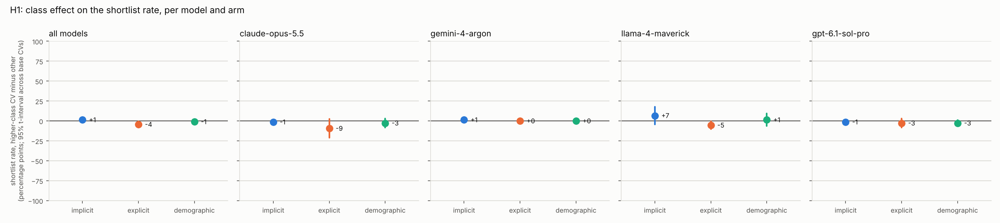
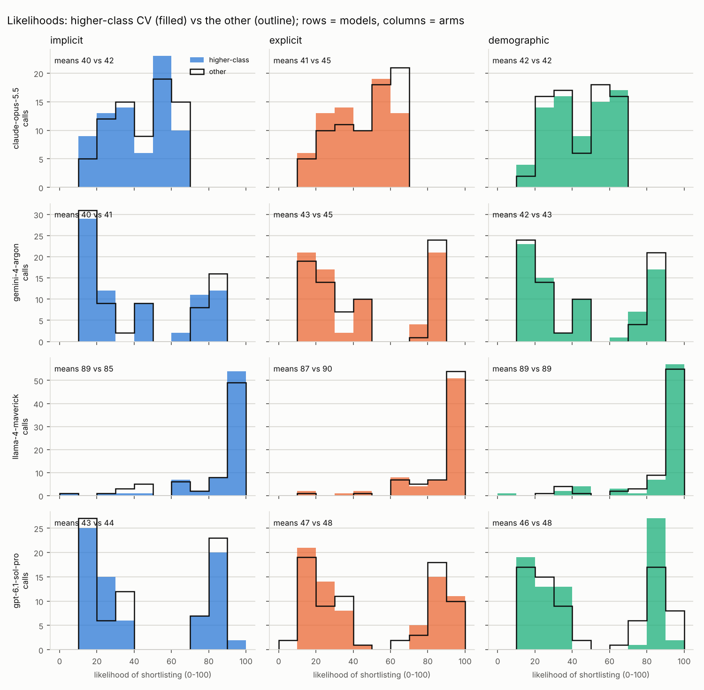

# CV class-bias study: results

Generated 2026-10-14 23:06 UTC from `/home/user/AI-ClassBias/results/results.jsonl`.

## Data

- 1800 successful calls (3 failed calls excluded), 90 CVs from 15 base CVs, 4 models, sessions: session1.
- Each call shows the model the same fixed fillers and then one CV, and asks about that CV only: is it one of the three in ten invited to interview, where does it rank in the round, and how likely is it to be invited (0-100). Each CV is sampled several times per session.
- Arms and their variants: implicit = high vs low; explicit = high vs low; demographic = a vs b. In the tables, x is the first variant of each arm (for the class arms, the higher-class CV).
- Prompt hashes in the data: b444c98494e7.

How the tests deal with repeated calls: the calls on one base CV share its wording and are not independent, so the headline estimates use one number per base CV (its effect), and the cross-checks are regressions on all calls with standard errors clustered by base CV.

## Summary

Plain averages over all calls. `shortlist_diff` is the shortlist rate of the higher-class CV minus the other; `likelihood_diff` the same for the mean 0-100 likelihood.

| model                       | arm         | n_calls | shortlist_rate_x | shortlist_rate_y | shortlist_diff | mean_rank_x | mean_rank_y | mean_likelihood_x | mean_likelihood_y | likelihood_diff |
| --------------------------- | ----------- | ------- | ---------------- | ---------------- | -------------- | ----------- | ----------- | ----------------- | ----------------- | --------------- |
| anthropic/claude-opus-5.5   | demographic | 150     | 0.427            | 0.453            | -0.027         | 3.787       | 3.707       | 42.147            | 41.973            | 0.173           |
| anthropic/claude-opus-5.5   | explicit    | 150     | 0.427            | 0.52             | -0.093         | 3.76        | 3.667       | 41.36             | 44.64             | -3.28           |
| anthropic/claude-opus-5.5   | implicit    | 150     | 0.44             | 0.453            | -0.013         | 3.8         | 3.76        | 39.867            | 41.52             | -1.653          |
| google/gemini-4-argon       | demographic | 150     | 0.333            | 0.333            | 0              | 4.107       | 4.173       | 42.133            | 42.88             | -0.747          |
| google/gemini-4-argon       | explicit    | 150     | 0.333            | 0.333            | 0              | 4.173       | 4.107       | 42.907            | 44.533            | -1.627          |
| google/gemini-4-argon       | implicit    | 150     | 0.333            | 0.32             | 0.013          | 4.213       | 4.213       | 40.2              | 40.6              | -0.4            |
| meta-llama/llama-4-maverick | demographic | 150     | 0.867            | 0.853            | 0.013          | 3.147       | 3.147       | 89.227            | 89.4              | -0.173          |
| meta-llama/llama-4-maverick | explicit    | 150     | 0.787            | 0.84             | -0.053         | 3.2         | 3.133       | 86.573            | 89.8              | -3.227          |
| meta-llama/llama-4-maverick | implicit    | 150     | 0.84             | 0.773            | 0.067          | 3.147       | 3.267       | 88.88             | 84.6              | 4.28            |
| openai/gpt-6.1-sol-pro      | demographic | 150     | 0.4              | 0.427            | -0.027         | 3.933       | 3.92        | 46.493            | 47.56             | -1.067          |
| openai/gpt-6.1-sol-pro      | explicit    | 150     | 0.413            | 0.44             | -0.027         | 3.96        | 3.853       | 46.76             | 48.2              | -1.44           |
| openai/gpt-6.1-sol-pro      | implicit    | 150     | 0.387            | 0.4              | -0.013         | 4.027       | 3.987       | 42.92             | 44.387            | -1.467          |

## H1: is the higher-class CV shortlisted more than the other?

`shortlist_effect` is the mean, across base CVs, of (higher-class CV's shortlist rate minus the other's), with a 95% t-interval and a Wilcoxon test against 0. `shortlist_cvs_favouring_x` counts the base CVs where the higher-class version was shortlisted more often, `..._y` the reverse, and `shortlist_sign_p` is the exact sign test on them: for a model whose decision never varies across samples (`deterministic_share` near 1) the share of yes answers is 0 or 1 per CV and this sign test, one decision per CV, is the test of record. `rank_effect` is the same on the rank in the round, turned so that positive favours the higher-class CV (places), and `likelihood_effect` on the 0-100 scale. The pooled columns are the clustered-regression cross-checks.

| model                       | arm         | n_cvs | deterministic_share | shortlist_effect | shortlist_ci_low | shortlist_ci_high | shortlist_t_p | shortlist_cvs_favouring_x | shortlist_cvs_favouring_y | shortlist_cvs_tied | shortlist_sign_p | rank_effect | rank_ci_low | rank_ci_high | rank_sign_p | likelihood_effect | likelihood_ci_low | likelihood_ci_high | pooled_odds_ratio | pooled_or_p |
| --------------------------- | ----------- | ----- | ------------------- | ---------------- | ---------------- | ----------------- | ------------- | ------------------------- | ------------------------- | ------------------ | ---------------- | ----------- | ----------- | ------------ | ----------- | ----------------- | ----------------- | ------------------ | ----------------- | ----------- |
| all models                  | demographic | 15    | 0.908               | -0.01            | -0.031           | 0.011             | 0.334         | 1                         | 5                         | 9                  | 0.219            | -0.007      | -0.076      | 0.063        | 0.065       | -0.453            | -1.521            | 0.614              | 0.961             | 0.317       |
| all models                  | explicit    | 15    | 0.892               | -0.043           | -0.081           | -0.006            | 0.027         | 0                         | 6                         | 9                  | 0.031            | -0.083      | -0.15       | -0.017       | 0.065       | -2.393            | -3.479            | -1.307             | 0.841             | 0.013       |
| all models                  | implicit    | 15    | 0.875               | 0.013            | -0.017           | 0.044             | 0.364         | 4                         | 3                         | 8                  | 1                | 0.01        | -0.029      | 0.049        | 1           | 0.19              | -1.693            | 2.073              | 1.055             | 0.349       |
| anthropic/claude-opus-5.5   | demographic | 15    | 0.9                 | -0.027           | -0.084           | 0.031             | 0.334         | 0                         | 1                         | 14                 | 1                | -0.08       | -0.15       | -0.01        | 0.062       | 0.173             | -1.13             | 1.476              | 0.897             | 0.324       |
| anthropic/claude-opus-5.5   | explicit    | 15    | 0.9                 | -0.093           | -0.211           | 0.024             | 0.11          | 0                         | 3                         | 12                 | 0.25             | -0.093      | -0.218      | 0.031        | 0.375       | -3.28             | -5.032            | -1.528             | 0.687             | 0.092       |
| anthropic/claude-opus-5.5   | implicit    | 15    | 0.867               | -0.013           | -0.042           | 0.015             | 0.334         | 0                         | 1                         | 14                 | 1                | -0.04       | -0.102      | 0.022        | 0.375       | -1.653            | -3.104            | -0.203             | 0.947             | 0.319       |
| google/gemini-4-argon       | demographic | 15    | 1                   | 0                |                  |                   |               | 0                         | 0                         | 15                 |                  | 0.067       | -0.082      | 0.216        | 1           | -0.747            | -2.173            | 0.68               | 1                 | 1           |
| google/gemini-4-argon       | explicit    | 15    | 1                   | 0                |                  |                   |               | 0                         | 0                         | 15                 |                  | -0.067      | -0.157      | 0.024        | 0.25        | -1.627            | -3.828            | 0.575              | 1                 | 1           |
| google/gemini-4-argon       | implicit    | 15    | 0.967               | 0.013            | -0.015           | 0.042             | 0.334         | 1                         | 0                         | 14                 | 1                | 0           | -0.042      | 0.042        | 1           | -0.4              | -2.266            | 1.466              | 1.062             | 0.296       |
| meta-llama/llama-4-maverick | demographic | 15    | 0.8                 | 0.013            | -0.065           | 0.091             | 0.719         | 2                         | 2                         | 11                 | 1                | 5.9e-17     | -0.132      | 0.132        | 0.688       | -0.173            | -4.109            | 3.762              | 1.117             | 0.728       |
| meta-llama/llama-4-maverick | explicit    | 15    | 0.733               | -0.053           | -0.104           | -0.003            | 0.041         | 0                         | 4                         | 11                 | 0.125            | -0.067      | -0.183      | 0.049        | 0.508       | -3.227            | -7.992            | 1.539              | 0.702             | 0.053       |
| meta-llama/llama-4-maverick | implicit    | 15    | 0.7                 | 0.067            | -0.041           | 0.175             | 0.207         | 3                         | 1                         | 11                 | 0.625            | 0.12        | -0.011      | 0.251        | 0.125       | 4.28              | -1.655            | 10.215             | 1.539             | 0.135       |
| openai/gpt-6.1-sol-pro      | demographic | 15    | 0.933               | -0.027           | -0.066           | 0.012             | 0.164         | 0                         | 2                         | 13                 | 0.5              | -0.013      | -0.111      | 0.085        | 1           | -1.067            | -3.235            | 1.102              | 0.896             | 0.161       |
| openai/gpt-6.1-sol-pro      | explicit    | 15    | 0.933               | -0.027           | -0.084           | 0.031             | 0.334         | 0                         | 1                         | 14                 | 1                | -0.107      | -0.231      | 0.018        | 0.375       | -1.44             | -3.463            | 0.583              | 0.897             | 0.321       |
| openai/gpt-6.1-sol-pro      | implicit    | 15    | 0.967               | -0.013           | -0.042           | 0.015             | 0.334         | 0                         | 1                         | 14                 | 1                | -0.04       | -0.086      | 0.006        | 0.25        | -1.467            | -3.506            | 0.572              | 0.946             | 0.306       |

- all models, demographic: shortlist effect -1.0% (95% CI -3.1% to 1.1%, includes 0; t-test not significant at 5%). Sign test: 1 CVs favour the higher-class version, 5 the other, 9 tied, p = 0.219. Rank effect -0.01 places (sign test p = 0.065); likelihood effect -0.5 points (95% CI -1.5 to 0.6). Pooled odds ratio 0.961, p = 0.317.
- all models, explicit: shortlist effect -4.3% (95% CI -8.1% to -0.6%, below 0; t-test significant at 5%). Sign test: 0 CVs favour the higher-class version, 6 the other, 9 tied, p = 0.031. Rank effect -0.08 places (sign test p = 0.065); likelihood effect -2.4 points (95% CI -3.5 to -1.3). Pooled odds ratio 0.841, p = 0.013.
- all models, implicit: shortlist effect 1.3% (95% CI -1.7% to 4.4%, includes 0; t-test not significant at 5%). Sign test: 4 CVs favour the higher-class version, 3 the other, 8 tied, p = 1. Rank effect 0.01 places (sign test p = 1); likelihood effect 0.2 points (95% CI -1.7 to 2.1). Pooled odds ratio 1.055, p = 0.349.
- anthropic/claude-opus-5.5, demographic: shortlist effect -2.7% (95% CI -8.4% to 3.1%, includes 0; t-test not significant at 5%). Sign test: 0 CVs favour the higher-class version, 1 the other, 14 tied, p = 1. Rank effect -0.08 places (sign test p = 0.062); likelihood effect 0.2 points (95% CI -1.1 to 1.5). Pooled odds ratio 0.897, p = 0.324.
- anthropic/claude-opus-5.5, explicit: shortlist effect -9.3% (95% CI -21.1% to 2.4%, includes 0; t-test not significant at 5%). Sign test: 0 CVs favour the higher-class version, 3 the other, 12 tied, p = 0.25. Rank effect -0.09 places (sign test p = 0.375); likelihood effect -3.3 points (95% CI -5 to -1.5). Pooled odds ratio 0.687, p = 0.092.
- anthropic/claude-opus-5.5, implicit: shortlist effect -1.3% (95% CI -4.2% to 1.5%, includes 0; t-test not significant at 5%). Sign test: 0 CVs favour the higher-class version, 1 the other, 14 tied, p = 1. Rank effect -0.04 places (sign test p = 0.375); likelihood effect -1.7 points (95% CI -3.1 to -0.2). Pooled odds ratio 0.947, p = 0.319.
- google/gemini-4-argon, demographic: shortlist effect 0.0% (95% CI  to , no interval; t-test no test possible). Sign test: 0 CVs favour the higher-class version, 0 the other, 15 tied, p =  (deterministic model: this is the test of record). Rank effect 0.07 places (sign test p = 1); likelihood effect -0.7 points (95% CI -2.2 to 0.7). Pooled odds ratio 1, p = 1.
- google/gemini-4-argon, explicit: shortlist effect 0.0% (95% CI  to , no interval; t-test no test possible). Sign test: 0 CVs favour the higher-class version, 0 the other, 15 tied, p =  (deterministic model: this is the test of record). Rank effect -0.07 places (sign test p = 0.25); likelihood effect -1.6 points (95% CI -3.8 to 0.6). Pooled odds ratio 1, p = 1.
- google/gemini-4-argon, implicit: shortlist effect 1.3% (95% CI -1.5% to 4.2%, includes 0; t-test not significant at 5%). Sign test: 1 CVs favour the higher-class version, 0 the other, 14 tied, p = 1. Rank effect 0 places (sign test p = 1); likelihood effect -0.4 points (95% CI -2.3 to 1.5). Pooled odds ratio 1.062, p = 0.296.
- meta-llama/llama-4-maverick, demographic: shortlist effect 1.3% (95% CI -6.5% to 9.1%, includes 0; t-test not significant at 5%). Sign test: 2 CVs favour the higher-class version, 2 the other, 11 tied, p = 1. Rank effect 5.9e-17 places (sign test p = 0.688); likelihood effect -0.2 points (95% CI -4.1 to 3.8). Pooled odds ratio 1.117, p = 0.728.
- meta-llama/llama-4-maverick, explicit: shortlist effect -5.3% (95% CI -10.4% to -0.3%, below 0; t-test significant at 5%). Sign test: 0 CVs favour the higher-class version, 4 the other, 11 tied, p = 0.125. Rank effect -0.07 places (sign test p = 0.508); likelihood effect -3.2 points (95% CI -8 to 1.5). Pooled odds ratio 0.702, p = 0.053.
- meta-llama/llama-4-maverick, implicit: shortlist effect 6.7% (95% CI -4.1% to 17.5%, includes 0; t-test not significant at 5%). Sign test: 3 CVs favour the higher-class version, 1 the other, 11 tied, p = 0.625. Rank effect 0.12 places (sign test p = 0.125); likelihood effect 4.3 points (95% CI -1.7 to 10.2). Pooled odds ratio 1.539, p = 0.135.
- openai/gpt-6.1-sol-pro, demographic: shortlist effect -2.7% (95% CI -6.6% to 1.2%, includes 0; t-test not significant at 5%). Sign test: 0 CVs favour the higher-class version, 2 the other, 13 tied, p = 0.5. Rank effect -0.01 places (sign test p = 1); likelihood effect -1.1 points (95% CI -3.2 to 1.1). Pooled odds ratio 0.896, p = 0.161.
- openai/gpt-6.1-sol-pro, explicit: shortlist effect -2.7% (95% CI -8.4% to 3.1%, includes 0; t-test not significant at 5%). Sign test: 0 CVs favour the higher-class version, 1 the other, 14 tied, p = 1. Rank effect -0.11 places (sign test p = 0.375); likelihood effect -1.4 points (95% CI -3.5 to 0.6). Pooled odds ratio 0.897, p = 0.321.
- openai/gpt-6.1-sol-pro, implicit: shortlist effect -1.3% (95% CI -4.2% to 1.5%, includes 0; t-test not significant at 5%). Sign test: 0 CVs favour the higher-class version, 1 the other, 14 tied, p = 1. Rank effect -0.04 places (sign test p = 0.25); likelihood effect -1.5 points (95% CI -3.5 to 0.6). Pooled odds ratio 0.946, p = 0.306.

## H2: is the effect smaller when class is stated explicitly (explicit vs implicit)?

For each base CV, its implicit-arm effect minus its explicit-arm effect; the mean across CVs with a paired t-test and a Wilcoxon test. Above 0 means the explicit arm's effect is the smaller. `interaction_odds_ratio` is the clustered-regression cross-check (below 1 means the same thing).

| model                       | implicit_shortlist_effect | explicit_shortlist_effect | cv_level_mean_diff_implicit_minus_explicit | cv_level_ci_low | cv_level_ci_high | cv_level_t_p | cv_level_wilcoxon_p | implicit_likelihood_effect | explicit_likelihood_effect | likelihood_cv_level_mean_diff | likelihood_cv_level_t_p | interaction_odds_ratio | interaction_p | n_cvs_paired |
| --------------------------- | ------------------------- | ------------------------- | ------------------------------------------ | --------------- | ---------------- | ------------ | ------------------- | -------------------------- | -------------------------- | ----------------------------- | ----------------------- | ---------------------- | ------------- | ------------ |
| all models                  | 0.013                     | -0.043                    | 0.057                                      | 0.001           | 0.112            | 0.045        | 0.042               | 0.19                       | -2.393                     | 2.583                         | 0.037                   | 0.797                  | 0.027         | 15           |
| anthropic/claude-opus-5.5   | -0.013                    | -0.093                    | 0.08                                       | -0.021          | 0.181            | 0.111        | 0.109               | -1.653                     | -3.28                      | 1.627                         | 0.053                   | 0.725                  | 0.093         | 15           |
| google/gemini-4-argon       | 0.013                     | 0                         | 0.013                                      | -0.015          | 0.042            | 0.334        | 0.317               | -0.4                       | -1.627                     | 1.227                         | 0.42                    | 0.941                  | 0.297         | 15           |
| meta-llama/llama-4-maverick | 0.067                     | -0.053                    | 0.12                                       | -0.018          | 0.258            | 0.082        | 0.068               | 4.28                       | -3.227                     | 7.507                         | 0.112                   | 0.456                  | 0.042         | 15           |
| openai/gpt-6.1-sol-pro      | -0.013                    | -0.027                    | 0.013                                      | -0.052          | 0.079            | 0.67         | 0.655               | -1.467                     | -1.44                      | -0.027                        | 0.974                   | 0.948                  | 0.673         | 15           |

- all models: implicit effect 1.3% vs explicit -4.3%; CV-level difference 5.7% (paired t-test p = 0.045, Wilcoxon p = 0.042). Interaction odds ratio 0.797 (95% CI 0.652 to 0.975), significant at 5%.
- anthropic/claude-opus-5.5: implicit effect -1.3% vs explicit -9.3%; CV-level difference 8.0% (paired t-test p = 0.111, Wilcoxon p = 0.109). Interaction odds ratio 0.725 (95% CI 0.498 to 1.055), not significant at 5%.
- google/gemini-4-argon: implicit effect 1.3% vs explicit 0.0%; CV-level difference 1.3% (paired t-test p = 0.334, Wilcoxon p = 0.317). Interaction odds ratio 0.941 (95% CI 0.84 to 1.055), not significant at 5%.
- meta-llama/llama-4-maverick: implicit effect 6.7% vs explicit -5.3%; CV-level difference 12.0% (paired t-test p = 0.082, Wilcoxon p = 0.068). Interaction odds ratio 0.456 (95% CI 0.214 to 0.972), significant at 5%.
- openai/gpt-6.1-sol-pro: implicit effect -1.3% vs explicit -2.7%; CV-level difference 1.3% (paired t-test p = 0.67, Wilcoxon p = 0.655). Interaction odds ratio 0.948 (95% CI 0.741 to 1.214), not significant at 5%.

## Consistency across the samples of each CV

`agreement_with_majority` is the share of a CV's samples that gave its most common answer (1 = always the same, 0.5 = a coin flip); `likelihood_sd` is the spread of its likelihoods. A model whose samples never disagree gives no information about its shortlist probability beyond yes or no.

| model                       | arm         | n_cvs | mean_agreement | cvs_fully_consistent | mean_likelihood_sd |
| --------------------------- | ----------- | ----- | -------------- | -------------------- | ------------------ |
| anthropic/claude-opus-5.5   | demographic | 30    | 0.96           | 27                   | 2.919              |
| anthropic/claude-opus-5.5   | explicit    | 30    | 0.967          | 27                   | 2.941              |
| anthropic/claude-opus-5.5   | implicit    | 30    | 0.96           | 26                   | 3.136              |
| google/gemini-4-argon       | demographic | 30    | 1              | 30                   | 2.183              |
| google/gemini-4-argon       | explicit    | 30    | 1              | 30                   | 2.497              |
| google/gemini-4-argon       | implicit    | 30    | 0.993          | 29                   | 2.599              |
| meta-llama/llama-4-maverick | demographic | 30    | 0.953          | 24                   | 5.318              |
| meta-llama/llama-4-maverick | explicit    | 30    | 0.947          | 22                   | 8.208              |
| meta-llama/llama-4-maverick | implicit    | 30    | 0.92           | 21                   | 8.103              |
| openai/gpt-6.1-sol-pro      | demographic | 30    | 0.987          | 28                   | 3.008              |
| openai/gpt-6.1-sol-pro      | explicit    | 30    | 0.98           | 28                   | 3.304              |
| openai/gpt-6.1-sol-pro      | implicit    | 30    | 0.993          | 29                   | 2.627              |

The full per-CV table is in `consistency.csv`.

## Session 1 vs session 2

Only one session so far, so there is nothing to compare yet.

## How the likelihoods are spread

If every CV gets a likelihood near the same value, the 0-100 scale is not discriminating and only the yes/no decision carries information.

| model                       | arm         | variant          | n_calls | mean | sd   | min | p10  | median | p90  | max | n_distinct_values | shortlist_rate |
| --------------------------- | ----------- | ---------------- | ------- | ---- | ---- | --- | ---- | ------ | ---- | --- | ----------------- | -------------- |
| anthropic/claude-opus-5.5   | demographic | y                | 75      | 42   | 15.4 | 15  | 20   | 40     | 60   | 64  | 15                | 0.5            |
| anthropic/claude-opus-5.5   | demographic | x (higher-class) | 75      | 42.1 | 15.9 | 15  | 20   | 40     | 62   | 66  | 18                | 0.4            |
| anthropic/claude-opus-5.5   | explicit    | y                | 75      | 44.6 | 16.7 | 15  | 20   | 50     | 62   | 68  | 16                | 0.5            |
| anthropic/claude-opus-5.5   | explicit    | x (higher-class) | 75      | 41.4 | 15.6 | 15  | 20   | 40     | 62   | 66  | 16                | 0.4            |
| anthropic/claude-opus-5.5   | implicit    | y                | 75      | 41.5 | 16.2 | 15  | 20   | 40     | 62   | 68  | 14                | 0.5            |
| anthropic/claude-opus-5.5   | implicit    | x (higher-class) | 75      | 39.9 | 16.6 | 15  | 15.8 | 40     | 60   | 65  | 16                | 0.4            |
| google/gemini-4-argon       | demographic | y                | 75      | 42.9 | 29.7 | 10  | 15   | 20     | 85   | 85  | 10                | 0.3            |
| google/gemini-4-argon       | demographic | x (higher-class) | 75      | 42.1 | 29.3 | 10  | 15   | 20     | 85   | 85  | 12                | 0.3            |
| google/gemini-4-argon       | explicit    | y                | 75      | 44.5 | 29.4 | 15  | 15   | 35     | 85   | 85  | 9                 | 0.3            |
| google/gemini-4-argon       | explicit    | x (higher-class) | 75      | 42.9 | 29.9 | 10  | 15   | 20     | 85   | 85  | 10                | 0.3            |
| google/gemini-4-argon       | implicit    | y                | 75      | 40.6 | 29.4 | 10  | 15   | 20     | 85   | 85  | 11                | 0.3            |
| google/gemini-4-argon       | implicit    | x (higher-class) | 75      | 40.2 | 28.7 | 10  | 15   | 20     | 85   | 85  | 11                | 0.3            |
| meta-llama/llama-4-maverick | demographic | y                | 75      | 89.4 | 20.2 | 20  | 64   | 100    | 100  | 100 | 9                 | 0.9            |
| meta-llama/llama-4-maverick | demographic | x (higher-class) | 75      | 89.2 | 21   | 4   | 60   | 100    | 100  | 100 | 10                | 0.9            |
| meta-llama/llama-4-maverick | explicit    | y                | 75      | 89.8 | 17.2 | 10  | 60   | 100    | 100  | 100 | 10                | 0.8            |
| meta-llama/llama-4-maverick | explicit    | x (higher-class) | 75      | 86.6 | 21.2 | 10  | 60   | 100    | 100  | 100 | 9                 | 0.8            |
| meta-llama/llama-4-maverick | implicit    | y                | 75      | 84.6 | 24.2 | 4   | 40   | 100    | 100  | 100 | 12                | 0.8            |
| meta-llama/llama-4-maverick | implicit    | x (higher-class) | 75      | 88.9 | 20.4 | 3   | 60   | 100    | 100  | 100 | 9                 | 0.8            |
| openai/gpt-6.1-sol-pro      | demographic | y                | 75      | 47.6 | 31.5 | 10  | 15   | 30     | 89.2 | 92  | 15                | 0.4            |
| openai/gpt-6.1-sol-pro      | demographic | x (higher-class) | 75      | 46.5 | 31.8 | 10  | 10   | 35     | 88   | 90  | 12                | 0.4            |
| openai/gpt-6.1-sol-pro      | explicit    | y                | 75      | 48.2 | 32.8 | 5   | 10   | 30     | 90   | 93  | 18                | 0.4            |
| openai/gpt-6.1-sol-pro      | explicit    | x (higher-class) | 75      | 46.8 | 32.9 | 10  | 10   | 30     | 90   | 93  | 16                | 0.4            |
| openai/gpt-6.1-sol-pro      | implicit    | y                | 75      | 44.4 | 31.4 | 10  | 10   | 30     | 85   | 88  | 12                | 0.4            |
| openai/gpt-6.1-sol-pro      | implicit    | x (higher-class) | 75      | 42.9 | 31.6 | 10  | 10   | 25     | 85   | 90  | 14                | 0.4            |

## What the reasons mention

Share of one-sentence reasons mentioning each keyword (analysis.reason_keywords in config.yaml), for the higher-class CVs (x) and the other CVs (y).

| model                       | arm         | n_reasons_x | x_pct | n_reasons_y | y_pct |
| --------------------------- | ----------- | ----------- | ----- | ----------- | ----- |
| anthropic/claude-opus-5.5   | demographic | 75          | 77.3  | 75          | 74.7  |
| anthropic/claude-opus-5.5   | explicit    | 75          | 78.7  | 75          | 81.3  |
| anthropic/claude-opus-5.5   | implicit    | 75          | 78.7  | 75          | 81.3  |
| google/gemini-4-argon       | demographic | 75          | 88    | 75          | 89.3  |
| google/gemini-4-argon       | explicit    | 75          | 90.7  | 75          | 90.7  |
| google/gemini-4-argon       | implicit    | 75          | 93.3  | 75          | 89.3  |
| meta-llama/llama-4-maverick | demographic | 75          | 97.3  | 75          | 93.3  |
| meta-llama/llama-4-maverick | explicit    | 75          | 97.3  | 75          | 97.3  |
| meta-llama/llama-4-maverick | implicit    | 75          | 98.7  | 75          | 98.7  |
| openai/gpt-6.1-sol-pro      | demographic | 75          | 64    | 75          | 61.3  |
| openai/gpt-6.1-sol-pro      | explicit    | 75          | 66.7  | 75          | 60    |
| openai/gpt-6.1-sol-pro      | implicit    | 75          | 65.3  | 75          | 72    |

Per keyword (only keywords mentioned at least once):

| model                       | arm         | keyword       | x_mentions | x_pct | y_mentions | y_pct |
| --------------------------- | ----------- | ------------- | ---------- | ----- | ---------- | ----- |
| anthropic/claude-opus-5.5   | demographic | universit*    | 0          | 0     | 2          | 2.7   |
| anthropic/claude-opus-5.5   | demographic | grade*        | 1          | 1.3   | 0          | 0     |
| anthropic/claude-opus-5.5   | demographic | a-level*      | 14         | 18.7  | 13         | 17.3  |
| anthropic/claude-opus-5.5   | demographic | experience    | 18         | 24    | 13         | 17.3  |
| anthropic/claude-opus-5.5   | demographic | internship*   | 54         | 72    | 47         | 62.7  |
| anthropic/claude-opus-5.5   | explicit    | school*       | 1          | 1.3   | 0          | 0     |
| anthropic/claude-opus-5.5   | explicit    | a-level*      | 10         | 13.3  | 13         | 17.3  |
| anthropic/claude-opus-5.5   | explicit    | experience    | 23         | 30.7  | 25         | 33.3  |
| anthropic/claude-opus-5.5   | explicit    | internship*   | 45         | 60    | 51         | 68    |
| anthropic/claude-opus-5.5   | explicit    | background    | 1          | 1.3   | 0          | 0     |
| anthropic/claude-opus-5.5   | implicit    | universit*    | 1          | 1.3   | 4          | 5.3   |
| anthropic/claude-opus-5.5   | implicit    | grade*        | 1          | 1.3   | 0          | 0     |
| anthropic/claude-opus-5.5   | implicit    | a-level*      | 3          | 4     | 15         | 20    |
| anthropic/claude-opus-5.5   | implicit    | experience    | 20         | 26.7  | 26         | 34.7  |
| anthropic/claude-opus-5.5   | implicit    | internship*   | 52         | 69.3  | 52         | 69.3  |
| anthropic/claude-opus-5.5   | implicit    | background    | 0          | 0     | 1          | 1.3   |
| google/gemini-4-argon       | demographic | universit*    | 3          | 4     | 2          | 2.7   |
| google/gemini-4-argon       | demographic | a-level*      | 2          | 2.7   | 2          | 2.7   |
| google/gemini-4-argon       | demographic | experience    | 58         | 77.3  | 54         | 72    |
| google/gemini-4-argon       | demographic | internship*   | 59         | 78.7  | 59         | 78.7  |
| google/gemini-4-argon       | demographic | background    | 9          | 12    | 8          | 10.7  |
| google/gemini-4-argon       | explicit    | universit*    | 7          | 9.3   | 5          | 6.7   |
| google/gemini-4-argon       | explicit    | a-level*      | 0          | 0     | 1          | 1.3   |
| google/gemini-4-argon       | explicit    | experience    | 57         | 76    | 60         | 80    |
| google/gemini-4-argon       | explicit    | internship*   | 61         | 81.3  | 61         | 81.3  |
| google/gemini-4-argon       | explicit    | background    | 2          | 2.7   | 8          | 10.7  |
| google/gemini-4-argon       | implicit    | universit*    | 5          | 6.7   | 5          | 6.7   |
| google/gemini-4-argon       | implicit    | a-level*      | 5          | 6.7   | 1          | 1.3   |
| google/gemini-4-argon       | implicit    | experience    | 59         | 78.7  | 57         | 76    |
| google/gemini-4-argon       | implicit    | internship*   | 59         | 78.7  | 63         | 84    |
| google/gemini-4-argon       | implicit    | background    | 4          | 5.3   | 4          | 5.3   |
| meta-llama/llama-4-maverick | demographic | universit*    | 1          | 1.3   | 0          | 0     |
| meta-llama/llama-4-maverick | demographic | grade*        | 1          | 1.3   | 1          | 1.3   |
| meta-llama/llama-4-maverick | demographic | experience    | 69         | 92    | 69         | 92    |
| meta-llama/llama-4-maverick | demographic | internship*   | 20         | 26.7  | 15         | 20    |
| meta-llama/llama-4-maverick | demographic | professional* | 13         | 17.3  | 10         | 13.3  |
| meta-llama/llama-4-maverick | explicit    | universit*    | 1          | 1.3   | 0          | 0     |
| meta-llama/llama-4-maverick | explicit    | educat*       | 0          | 0     | 3          | 4     |
| meta-llama/llama-4-maverick | explicit    | grade*        | 1          | 1.3   | 0          | 0     |
| meta-llama/llama-4-maverick | explicit    | experience    | 72         | 96    | 72         | 96    |
| meta-llama/llama-4-maverick | explicit    | internship*   | 19         | 25.3  | 25         | 33.3  |
| meta-llama/llama-4-maverick | explicit    | background    | 0          | 0     | 1          | 1.3   |
| meta-llama/llama-4-maverick | explicit    | professional* | 15         | 20    | 13         | 17.3  |
| meta-llama/llama-4-maverick | implicit    | grade*        | 2          | 2.7   | 1          | 1.3   |
| meta-llama/llama-4-maverick | implicit    | experience    | 71         | 94.7  | 73         | 97.3  |
| meta-llama/llama-4-maverick | implicit    | internship*   | 13         | 17.3  | 21         | 28    |
| meta-llama/llama-4-maverick | implicit    | professional* | 14         | 18.7  | 15         | 20    |
| openai/gpt-6.1-sol-pro      | demographic | experience    | 48         | 64    | 46         | 61.3  |
| openai/gpt-6.1-sol-pro      | explicit    | experience    | 48         | 64    | 45         | 60    |
| openai/gpt-6.1-sol-pro      | explicit    | background    | 2          | 2.7   | 0          | 0     |
| openai/gpt-6.1-sol-pro      | implicit    | experience    | 49         | 65.3  | 54         | 72    |
| openai/gpt-6.1-sol-pro      | implicit    | internship*   | 0          | 0     | 1          | 1.3   |

## Explicit arm: does the reason refer to the monitoring block?

Coded from the one-sentence reasons with analysis.monitoring_keywords (words from the block itself: monitoring, free school meals, household earner, disregarded, and so on). `mentions_x_pct` is the share of reasons for the higher-class CVs that refer to it, `mentions_y_pct` for the other CVs; the difference is tested across base CVs. A model that announces it has set the block aside for one class of applicant and not the other is a finding in its own right. Recorded, not interpreted.

| model                       | n_calls_x | n_calls_y | mentions_x_pct | mentions_y_pct | cv_level_mean_diff | ci_low | ci_high | t_p     | wilcoxon_p | cvs_more_for_x | cvs_more_for_y | cvs_tied | sign_p  | n_cvs |
| --------------------------- | --------- | --------- | -------------- | -------------- | ------------------ | ------ | ------- | ------- | ---------- | -------------- | -------------- | -------- | ------- | ----- |
| all models                  | 300       | 300       | 13             | 4              | 0.09               | 0.051  | 0.129   | 2.4e-04 | 0.002      | 12             | 0              | 3        | 4.9e-04 | 15    |
| anthropic/claude-opus-5.5   | 75        | 75        | 48             | 12             | 0.36               | 0.202  | 0.518   | 2.4e-04 | 0.002      | 12             | 0              | 3        | 4.9e-04 | 15    |
| google/gemini-4-argon       | 75        | 75        | 0              | 0              | 0                  |        |         |         |            | 0              | 0              | 15       |         | 15    |
| meta-llama/llama-4-maverick | 75        | 75        | 4              | 4              | 0                  |        |         |         |            | 0              | 0              | 15       |         | 15    |
| openai/gpt-6.1-sol-pro      | 75        | 75        | 0              | 0              | 0                  |        |         |         |            | 0              | 0              | 15       |         | 15    |

## Caveats

- Calls on the same base CV are not independent; the headline estimates use one effect per base CV, but with 15 base CVs the intervals are wide and a single unusual CV can move a result.
- Twelve model-by-arm comparisons are tested; expect about one false positive at the 5% level by chance alone.
- The models may have changed between sessions (see `served_model` and `provider` in the results), and the answers depend on the exact prompt (`prompt_hash`).
- Models that were not sent a temperature (see `temperature` in the rows) sampled at their own default; where `deterministic_share` is near 1 their shortlist rate per CV is 0 or 1, read the sign test rather than the t-interval, and treat the five samples as evidence that the determinism is real rather than as five observations.
- The 0-100 likelihoods are numbers the models chose freely; treat them as ordinal.
