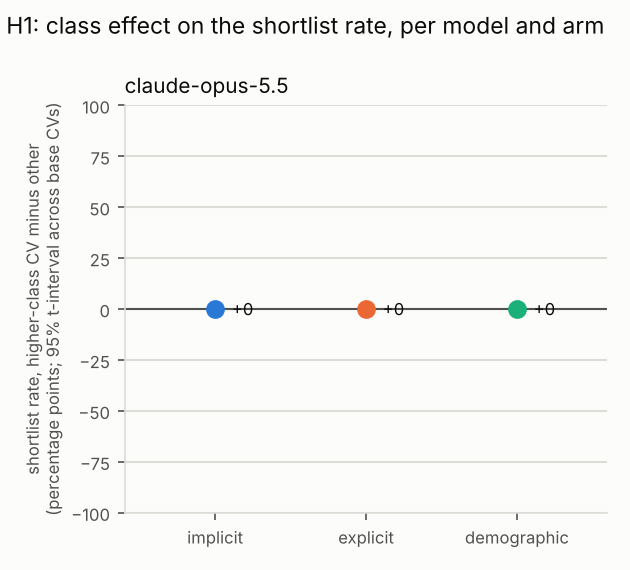
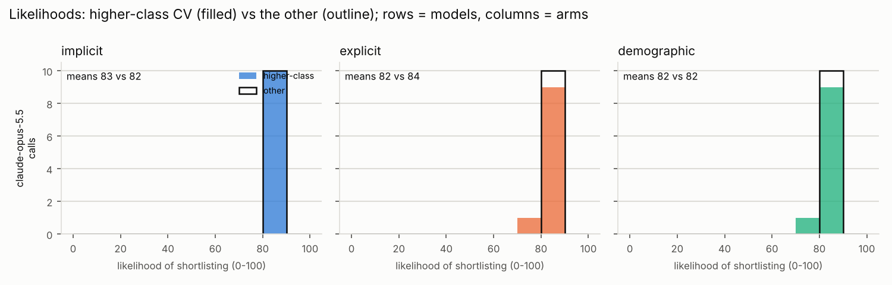

# CV class-bias study: results

Generated 2026-10-14 19:39 UTC from `/home/user/AI-ClassBias/results_pilot2/results.jsonl`.

## Data

- 60 successful calls (0 failed calls excluded), 12 CVs from 2 base CVs, 1 models, sessions: pilot2.
- Each call shows the model one CV; the model says whether it would shortlist the applicant and gives a 0-100 likelihood. Each CV is sampled several times per session.
- Arms and their variants: implicit = high vs low; explicit = high vs low; demographic = a vs b. In the tables, x is the first variant of each arm (for the class arms, the higher-class CV).
- Prompt hashes in the data: 2214bb26c803.

How the tests deal with repeated calls: the calls on one base CV share its wording and are not independent, so the headline estimates use one number per base CV (its effect), and the cross-checks are regressions on all calls with standard errors clustered by base CV.

## Summary

Plain averages over all calls. `shortlist_diff` is the shortlist rate of the higher-class CV minus the other; `likelihood_diff` the same for the mean 0-100 likelihood.

| model                     | arm         | n_calls | shortlist_rate_x | shortlist_rate_y | shortlist_diff | mean_likelihood_x | mean_likelihood_y | likelihood_diff |
| ------------------------- | ----------- | ------- | ---------------- | ---------------- | -------------- | ----------------- | ----------------- | --------------- |
| anthropic/claude-opus-5.5 | demographic | 20      | 1                | 1                | 0              | 82.4              | 82.5              | -0.1            |
| anthropic/claude-opus-5.5 | explicit    | 20      | 1                | 1                | 0              | 82.3              | 83.7              | -1.4            |
| anthropic/claude-opus-5.5 | implicit    | 20      | 1                | 1                | 0              | 83.3              | 82.2              | 1.1             |

## H1: is the higher-class CV shortlisted more than the other?

`shortlist_effect` is the mean, across base CVs, of (higher-class CV's shortlist rate minus the other's), with a 95% t-interval and a Wilcoxon test against 0; `likelihood_effect` the same on the 0-100 scale. H1 is supported for a model and arm when the whole interval lies above 0. The pooled columns are the clustered-regression cross-checks.

| model                     | arm         | n_calls | n_cvs | shortlist_effect | shortlist_ci_low | shortlist_ci_high | shortlist_t_p | shortlist_wilcoxon_p | likelihood_effect | likelihood_ci_low | likelihood_ci_high | likelihood_t_p | pooled_odds_ratio | pooled_or_p |
| ------------------------- | ----------- | ------- | ----- | ---------------- | ---------------- | ----------------- | ------------- | -------------------- | ----------------- | ----------------- | ------------------ | -------------- | ----------------- | ----------- |
| anthropic/claude-opus-5.5 | demographic | 20      | 2     | 0                |                  |                   |               |                      | -0.1              | -3.912            | 3.712              | 0.795          |                   |             |
| anthropic/claude-opus-5.5 | explicit    | 20      | 2     | 0                |                  |                   |               |                      | -1.4              | -19.189           | 16.389             | 0.5            |                   |             |
| anthropic/claude-opus-5.5 | implicit    | 20      | 2     | 0                |                  |                   |               |                      | 1.1               | -5.253            | 7.453              | 0.272          |                   |             |

- anthropic/claude-opus-5.5, demographic: shortlist effect 0.0% (95% CI  to , no interval; t-test no test possible, Wilcoxon p = ). Likelihood effect -0.1 points (95% CI -3.9 to 3.7). Pooled odds ratio , p = . Note: not enough variation to estimate the effect.
- anthropic/claude-opus-5.5, explicit: shortlist effect 0.0% (95% CI  to , no interval; t-test no test possible, Wilcoxon p = ). Likelihood effect -1.4 points (95% CI -19.2 to 16.4). Pooled odds ratio , p = . Note: not enough variation to estimate the effect.
- anthropic/claude-opus-5.5, implicit: shortlist effect 0.0% (95% CI  to , no interval; t-test no test possible, Wilcoxon p = ). Likelihood effect 1.1 points (95% CI -5.3 to 7.5). Pooled odds ratio , p = . Note: not enough variation to estimate the effect.

## H2: is the effect smaller when class is stated explicitly (explicit vs implicit)?

For each base CV, its implicit-arm effect minus its explicit-arm effect; the mean across CVs with a paired t-test and a Wilcoxon test. Above 0 means the explicit arm's effect is the smaller. `interaction_odds_ratio` is the clustered-regression cross-check (below 1 means the same thing).

| model                     | implicit_shortlist_effect | explicit_shortlist_effect | cv_level_mean_diff_implicit_minus_explicit | cv_level_ci_low | cv_level_ci_high | cv_level_t_p | cv_level_wilcoxon_p | implicit_likelihood_effect | explicit_likelihood_effect | likelihood_cv_level_mean_diff | likelihood_cv_level_t_p | interaction_odds_ratio | interaction_p | n_cvs_paired |
| ------------------------- | ------------------------- | ------------------------- | ------------------------------------------ | --------------- | ---------------- | ------------ | ------------------- | -------------------------- | -------------------------- | ----------------------------- | ----------------------- | ---------------------- | ------------- | ------------ |
| anthropic/claude-opus-5.5 | 0                         | 0                         | 0                                          |                 |                  |              |                     | 1.1                        | -1.4                       | 2.5                           | 0.414                   |                        |               | 2            |

- anthropic/claude-opus-5.5: implicit effect 0.0% vs explicit 0.0%; CV-level difference 0.0% (paired t-test p = , Wilcoxon p = ). Interaction odds ratio  (95% CI  to ), no test possible.

## Consistency across the samples of each CV

`agreement_with_majority` is the share of a CV's samples that gave its most common answer (1 = always the same, 0.5 = a coin flip); `likelihood_sd` is the spread of its likelihoods. A model whose samples never disagree gives no information about its shortlist probability beyond yes or no.

| model                     | arm         | n_cvs | mean_agreement | cvs_fully_consistent | mean_likelihood_sd |
| ------------------------- | ----------- | ----- | -------------- | -------------------- | ------------------ |
| anthropic/claude-opus-5.5 | demographic | 4     | 1              | 4                    | 0.3                |
| anthropic/claude-opus-5.5 | explicit    | 4     | 1              | 4                    | 0.761              |
| anthropic/claude-opus-5.5 | implicit    | 4     | 1              | 4                    | 0.5                |

The full per-CV table is in `consistency.csv`.

## Session 1 vs session 2

Only one session so far, so there is nothing to compare yet.

## How the likelihoods are spread

If every CV gets a likelihood near the same value, the 0-100 scale is not discriminating and only the yes/no decision carries information.

| model                     | arm         | variant          | n_calls | mean | sd  | min | p10  | median | p90  | max | n_distinct_values | shortlist_rate |
| ------------------------- | ----------- | ---------------- | ------- | ---- | --- | --- | ---- | ------ | ---- | --- | ----------------- | -------------- |
| anthropic/claude-opus-5.5 | demographic | y                | 10      | 82.5 | 2.5 | 80  | 80   | 82.5   | 85   | 85  | 2                 | 1              |
| anthropic/claude-opus-5.5 | demographic | x (higher-class) | 10      | 82.4 | 2.9 | 78  | 79.8 | 82.5   | 85.1 | 86  | 4                 | 1              |
| anthropic/claude-opus-5.5 | explicit    | y                | 10      | 83.7 | 2.1 | 80  | 80   | 85     | 85   | 85  | 3                 | 1              |
| anthropic/claude-opus-5.5 | explicit    | x (higher-class) | 10      | 82.3 | 2.8 | 78  | 79.8 | 82.5   | 85   | 85  | 3                 | 1              |
| anthropic/claude-opus-5.5 | implicit    | y                | 10      | 82.2 | 2.4 | 80  | 80   | 81     | 85   | 85  | 3                 | 1              |
| anthropic/claude-opus-5.5 | implicit    | x (higher-class) | 10      | 83.3 | 1.8 | 80  | 81.8 | 83.5   | 85   | 85  | 3                 | 1              |

## What the reasons mention

Share of one-sentence reasons mentioning each keyword (analysis.reason_keywords in config.yaml), for the higher-class CVs (x) and the other CVs (y).

| model                     | arm         | n_reasons_x | x_pct | n_reasons_y | y_pct |
| ------------------------- | ----------- | ----------- | ----- | ----------- | ----- |
| anthropic/claude-opus-5.5 | demographic | 10          | 100   | 10          | 100   |
| anthropic/claude-opus-5.5 | explicit    | 10          | 100   | 10          | 100   |
| anthropic/claude-opus-5.5 | implicit    | 10          | 100   | 10          | 100   |

Per keyword (only keywords mentioned at least once):

| model                     | arm         | keyword       | x_mentions | x_pct | y_mentions | y_pct |
| ------------------------- | ----------- | ------------- | ---------- | ----- | ---------- | ----- |
| anthropic/claude-opus-5.5 | demographic | a-level*      | 9          | 90    | 7          | 70    |
| anthropic/claude-opus-5.5 | demographic | interest*     | 10         | 100   | 10         | 100   |
| anthropic/claude-opus-5.5 | demographic | experience    | 6          | 60    | 4          | 40    |
| anthropic/claude-opus-5.5 | demographic | internship*   | 9          | 90    | 6          | 60    |
| anthropic/claude-opus-5.5 | explicit    | a-level*      | 5          | 50    | 10         | 100   |
| anthropic/claude-opus-5.5 | explicit    | interest*     | 10         | 100   | 8          | 80    |
| anthropic/claude-opus-5.5 | explicit    | experience    | 5          | 50    | 5          | 50    |
| anthropic/claude-opus-5.5 | explicit    | internship*   | 7          | 70    | 7          | 70    |
| anthropic/claude-opus-5.5 | explicit    | professional* | 1          | 10    | 0          | 0     |
| anthropic/claude-opus-5.5 | implicit    | a-level*      | 5          | 50    | 8          | 80    |
| anthropic/claude-opus-5.5 | implicit    | interest*     | 10         | 100   | 10         | 100   |
| anthropic/claude-opus-5.5 | implicit    | experience    | 4          | 40    | 4          | 40    |
| anthropic/claude-opus-5.5 | implicit    | internship*   | 7          | 70    | 7          | 70    |

## Caveats

- Calls on the same base CV are not independent; the headline estimates use one effect per base CV, but with 15 base CVs the intervals are wide and a single unusual CV can move a result.
- Twelve model-by-arm comparisons are tested; expect about one false positive at the 5% level by chance alone.
- The models may have changed between sessions (see `served_model` and `provider` in the results), and the answers depend on the exact prompt (`prompt_hash`).
- Models that were not sent a temperature (see `temperature` in the rows) sampled at their own default; check the consistency table before reading their shortlist rates as probabilities.
- The 0-100 likelihoods are numbers the models chose freely; treat them as ordinal.
